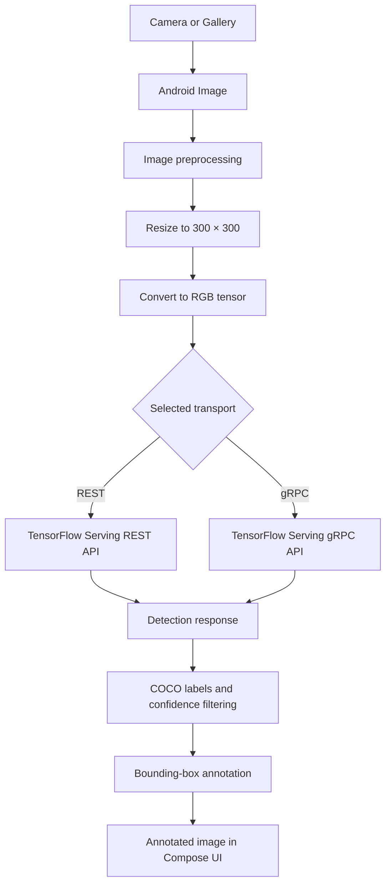

# Nurosee — Android Object Detection

**Nurosee** is an Android application that detects everyday objects in images using an SSD MobileNet V2 model trained on the COCO dataset. It provides a native interface for selecting or capturing an image, choosing an inference transport, and viewing the detected objects with confidence scores and bounding boxes.

The application supports two ways to communicate with the inference backend:

- **REST:** sends image tensors through a JSON-based TensorFlow Serving prediction endpoint.
- **gRPC:** sends image tensors through TensorFlow Serving's gRPC prediction service using Protocol Buffers.

The Android client is built with Kotlin and Jetpack Compose. Model inference runs remotely; this repository contains the Android client, not a model-training pipeline.

## Features

- Select an image from the device gallery.
- Capture a picture using the device camera.
- Switch between REST and gRPC inference.
- Resize and convert images to the model's expected RGB tensor format.
- Display detected objects with labels, confidence scores and bounding boxes.
- Preview the selected or annotated image in full screen.
- Handle loading, network errors, request timeouts and retry attempts.
- Provide English and French UI resources.

## Application workflow

1. Choose the inference method: REST or gRPC.
2. Select an image from the gallery or capture one with the camera.
3. The application resizes the image to **300 × 300** pixels.
4. The image is converted into an RGB pixel tensor.
5. The tensor is sent to the selected inference endpoint.
6. The application receives detection classes, confidence scores and bounding boxes.
7. The original image is annotated and displayed with the detected objects.

## Architecture



### Android application structure

```text
Object-Detector/
├── app/
│   └── src/main/
│       ├── java/com/example/objectdetector/
│       │   ├── MainActivity.kt
│       │   ├── data/
│       │   │   └── DataSource.kt
│       │   ├── model/
│       │   │   └── ApiType.kt
│       │   ├── network/
│       │   │   ├── RestApiService.kt
│       │   │   ├── GrpcApiService.kt
│       │   │   ├── PredictionRequest.kt
│       │   │   └── PredictionResponse.kt
│       │   └── ui/
│       │       ├── AppUiScreen.kt
│       │       ├── AppUiState.kt
│       │       ├── AppViewModel.kt
│       │       ├── components/
│       │       └── theme/
│       └── proto/
│           ├── tensorflow/
│           └── tensorflow_serving/
├── gradle/
├── build.gradle.kts
├── settings.gradle.kts
└── gradlew
```

## Technology stack

| Area | Technologies |
|---|---|
| Language | Kotlin |
| Android UI | Jetpack Compose, Material 3 |
| Architecture | ViewModel, StateFlow, Kotlin Coroutines |
| Image loading | Coil |
| REST communication | Retrofit, OkHttp, Kotlin Serialization |
| gRPC communication | gRPC Kotlin, Protocol Buffers |
| Model serving | TensorFlow Serving |
| Build system | Gradle Kotlin DSL |

The project currently declares Android Gradle Plugin **8.9.2**, Gradle **8.11.1**, Kotlin Android **2.0.21**, and Compose UI dependencies through the Compose BOM.

## Model and inference contract

The application is designed to work with **SSD MobileNet V2 trained on COCO**. The original model is listed in the [TensorFlow Detection Model Zoo](https://github.com/tensorflow/models/blob/master/research/object_detection/g3doc/tf1_detection_zoo.md).

### Input tensor

The image is resized to 300 × 300 and represented as RGB pixel values in the range 0–255.

| Property | Value |
|---|---|
| Batch size | 1 |
| Height | 300 |
| Width | 300 |
| Channels | 3 (RGB) |
| Tensor shape | `[1, 300, 300, 3]` |
| Pixel type | Unsigned 8-bit integer values |

### REST request

The REST client uses the TensorFlow Serving prediction endpoint:

```http
POST /v1/models/mobilenet_ssd:predict
Content-Type: application/json
```

The JSON request contains an `instances` field holding the image tensor:

```json
{
  "instances": [
    [
      [
        [120, 90, 70],
        [121, 91, 72]
      ]
    ]
  ]
}
```

The example above illustrates the nesting only; a real request contains the complete 300 × 300 image tensor.

### gRPC request

The gRPC client constructs a TensorFlow `TensorProto` with:

- Data type: `DT_UINT8`
- Shape: `[1, 300, 300, 3]`
- Input name: `inputs`
- Model name: `mobilenet_ssd`
- Signature name: `serving_default`

It requests the following outputs:

- `num_detections`
- `detection_boxes`
- `detection_classes`
- `detection_scores`

### Detection response

Both transports are normalized into the same application response structure:

```json
{
  "predictions": [
    {
      "num_detections": 2,
      "detection_classes": [1, 3],
      "detection_scores": [0.97, 0.89],
      "detection_boxes": [
        [0.10, 0.15, 0.60, 0.55],
        [0.20, 0.50, 0.80, 0.90]
      ]
    }
  ]
}
```

The values above are illustrative, not measured model output. Bounding boxes use normalized coordinates in the order `[ymin, xmin, ymax, xmax]`. The UI ignores detections with a confidence score below **0.30** and maps the remaining class IDs to the application's COCO label resources.

## Backend configuration

The application communicates with remote inference services. Their addresses are currently configured in the source code:

| Transport | Configuration file | Configuration |
|---|---|---|
| REST | `network/RestApiService.kt` | Base URL and prediction route |
| gRPC | `network/GrpcApiService.kt` | Host, port and model signature |

The current gRPC client uses TLS on port `443`. The REST client uses the TensorFlow Serving route `/v1/models/mobilenet_ssd:predict`.

To connect the application to your own deployment, update these values in the corresponding service files. For a maintainable deployment setup, consider moving endpoint values into build configuration or environment-specific configuration rather than keeping them as source-code constants.

The REST and gRPC endpoints are separate service targets in the current application. The companion [`mobilenet-rest`](https://github.com/medaich/mobilenet-rest) repository documents the REST-serving container; its Dockerfile does not, by itself, provision the separate gRPC endpoint.

## Build and run

### Prerequisites

- Android Studio.
- Android SDK Platform 35.
- JDK 17 for running the Gradle build.
- A connected Android device or emulator running Android 7.0 (API 24) or newer.
- Accessible REST and/or gRPC inference endpoints.

### Clone the repository

```bash
git clone https://github.com/medaich/Object-Detector.git
cd Object-Detector
```

Open the project directory in Android Studio and allow Gradle to synchronize.

### Build the debug APK

On Windows:

```powershell
.\gradlew.bat assembleDebug
```

On macOS or Linux:

```bash
./gradlew assembleDebug
```

The debug APK is generated at:

```text
app/build/outputs/apk/debug/app-debug.apk
```

### Install on a connected device

Windows:

```powershell
.\gradlew.bat installDebug
```

macOS or Linux:

```bash
./gradlew installDebug
```

Before testing inference, verify that the configured backend endpoints are reachable from the device or emulator.

## Reliability and error handling

The ViewModel includes:

- A 30-second request timeout.
- Up to three attempts for an inference request.
- Increasing delays between retry attempts.
- Loading, success and error states exposed through `StateFlow`.
- User-facing messages for common connectivity and request failures.
- Graceful shutdown of the gRPC channel when the ViewModel is cleared.

## Important implementation notes

- Inference is performed remotely. The app requires network connectivity and does not perform offline model inference.
- Images are resized to a fixed 300 × 300 resolution before inference.
- The model input contains RGB pixel values; preprocessing must remain compatible with the deployed model signature.
- Images selected or captured by the user are transmitted to the configured inference service. Use an endpoint and data-handling policy appropriate for the images being processed.
- The current confidence threshold for rendering detections is 0.30.

## Related repository

- [mobilenet-rest — TensorFlow Serving REST deployment](https://github.com/medaich/mobilenet-rest)

## License

No license file is currently included in this repository. Add an appropriate license before explicitly granting others permission to reuse or distribute the application.
